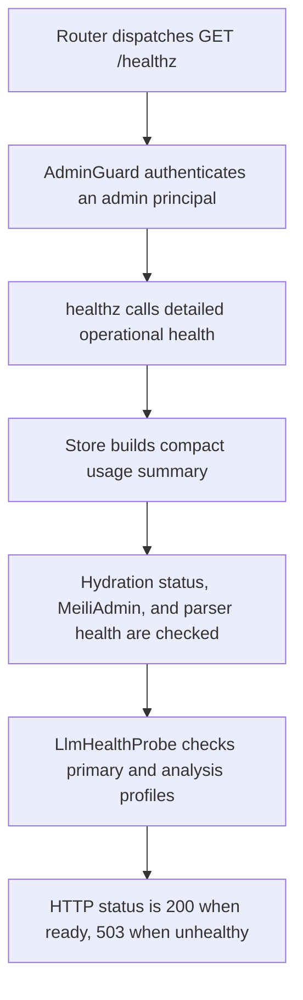

# GET /healthz

## Summary
Admin-only operational diagnostics for Meilisearch, startup hydration, parser, LLM health, store backend, and compact usage.

## Handler
- Rust handler: `healthz`
- Route registration: `src/routes.rs::build_router`
- Authentication: AdminGuard required

## Path Parameters
None.

## Query Parameters
None.

## JSON Body Parameters
No JSON body.

## Response
Schema: `HealthResponse`

| Field | Type | Description |
| --- | --- | --- |
| status | string | ok, degraded, or unhealthy. |
| ready | boolean | True when mandatory hydration completed and Meilisearch, parser, and required LLM checks allow traffic. |
| version | string | Crate version baked in at compile time. |
| git_rev | string | Short git revision of the build, `-dirty` suffix when built from a modified tree, `unknown` outside a git checkout. |
| store_backend | string | Active store backend name. |
| meilisearch | object | Meilisearch health payload. |
| hydration | object | Tenant hydration status plus per-domain durability strategy, counts, recovery totals, and redacted failure diagnostics. |
| parser | object | Parser health payload. |
| llm | object | Primary LLM health payload with provider, model, auth, quota, rate-limit, and stale status. |
| analysis_llm | object | Analysis-profile LLM health payload. A distinct analysis profile is probed independently and can make readiness unhealthy. |
| usage | object | Compact usage summary. |

### `llm` Credential Fields
| Field | Type | Description |
| --- | --- | --- |
| auth_token_kind | string? | Credential shape behind the provider: `codex_oauth`, `openai_api_key` or `other`. Absent when no credential is loaded or the provider is not `codex_auth`. |
| auth_expires_at | RFC 3339? | Expiry of the active Codex OAuth access token, read from the JWT `exp` claim (signature not verified — informational only). Absent for API keys. |
| auth_expires_in_seconds | integer? | Seconds until `auth_expires_at`; negative once the sign-in has already expired. Lets dashboards warn before the next probe reports `auth_failed`. |

The same fields are present under `analysis_llm`.

### `llm.rate_limits` Fields
The freshest live snapshot for the configured provider. Health probes and
real completions (RAG answer, analysis, title) both refresh it; `captured_at`
says when it was last observed. For `codex_auth` the windows come from the
`x-codex-*` response headers of the ChatGPT Codex backend.

| Field | Type | Description |
| --- | --- | --- |
| captured_at | string? | RFC3339 time the snapshot was observed on a live upstream response. |
| plan_type | string? | Codex subscription plan (`x-codex-plan-type`). |
| active_limit | string? | Limit bucket currently governing (`x-codex-active-limit`). |
| primary | object? | First Codex usage window (`x-codex-primary-*`): `used_percent`, `remaining_percent`, `window_minutes`, `window_label`, `resets_in_seconds`, `resets_at`. |
| secondary | object? | Second Codex usage window (`x-codex-secondary-*`), same fields as `primary`. |
| credits | object? | `has_credits`, `unlimited`, `balance` from the Codex credits headers. |
| additional_limits | array? | Model-scoped buckets (`name`, `limit_name`, `primary`, `secondary`). |
| remaining_requests / remaining_tokens / reset_requests / reset_tokens | string? | OpenAI API-style `x-ratelimit-*` values when the provider is `openai_api_key`. |

The same fields are present under `analysis_llm.rate_limits`.
`llm.rate_limit_state` and `analysis_llm.rate_limit_state` are `ok`, `near_limit` (any window ≥ 90% used),
`limited` (any window ≥ 100% used or upstream 429), or `unknown`.
`remaining_percent` is the "left available usage" for dashboards.

Window lengths are not fixed: read `window_minutes` (from
`x-codex-*-window-minutes`) and the derived `window_label` (largest whole unit,
e.g. `5h`, `7d`, `90m`) instead of assuming which slot is short or long. Either
window may be absent; a zero-length, zero-usage placeholder that Codex sends
for a limit it no longer enforces is reported as absent. As of 2026-11 Codex
reports a single 7-day window in `primary` (`window_minutes: 10080`) and only
that placeholder in `secondary`.

## Errors and Access Rules
- Missing or invalid bearer authentication returns 401.
- Authenticated non-admin principals return 403.
- Returns 200 when ready and 503 when mandatory hydration or dependency health makes the service unready.
- This protected route may expose operational budgets and private aggregate counts to admins; public callers must use `/readyz`.

## Internal Logic Call Graph

