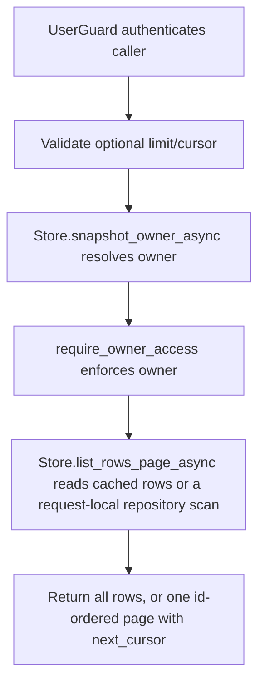

# GET /v1/history/structured/snapshots/{snapshot_id}/rows

## Summary
List rows attached to a structured snapshot.

## Handler
- Rust handler: `list_rows`
- Route registration: `src/routes.rs::build_router`
- Authentication: UserGuard; snapshot owner enforced

## Path Parameters
| Name | Type | Description |
| --- | --- | --- |
| snapshot_id | string | Structured snapshot identifier. |

## Query Parameters
| Name | Type | Description |
| --- | --- | --- |
| limit | integer? | Optional page size, 1 through `RAG_MAX_BULK_ROWS`. Supplying `limit` or `cursor` switches to paginated mode. |
| cursor | string? | Opaque `next_cursor` value from the previous page. Without `limit`, the page size defaults to 500 (capped by `RAG_MAX_BULK_ROWS`). |

Without either parameter the endpoint keeps its original behavior: every row,
in stored order, with no `next_cursor` field. Large snapshots should paginate
so the response stays under the 16 MiB JSON sanitizer ceiling.

## JSON Body Parameters
No JSON body.

## Response
Schema: `JsonValue`

| Field | Type | Description |
| --- | --- | --- |
| snapshot_id | string | Requested snapshot id. |
| rows | object[] | Row documents. Paginated pages are ordered by row `id` ascending. |
| next_cursor | string? | Paginated mode only. Cursor for the next page, or `null` on the last page. |

Pagination is keyset-based on the row `id`, so rows appended while a client
pages are never duplicated or shifted on later pages. A snapshot whose rows
are not already resident in the process is read through the repository for
the request only; read-only listing does not grow the in-process row cache.

## Errors and Access Rules
- `limit=0`, a `limit` above `RAG_MAX_BULK_ROWS`, or a malformed `cursor`
  returns 400 `validation_error` with `details.field` set to `limit` or
  `cursor`.
- Owner-scoped endpoints return 403 when the authenticated principal cannot access the requested owner.
- Store, Meilisearch, or LLM failures are returned through the shared ApiError JSON envelope.

## Internal Logic Call Graph

